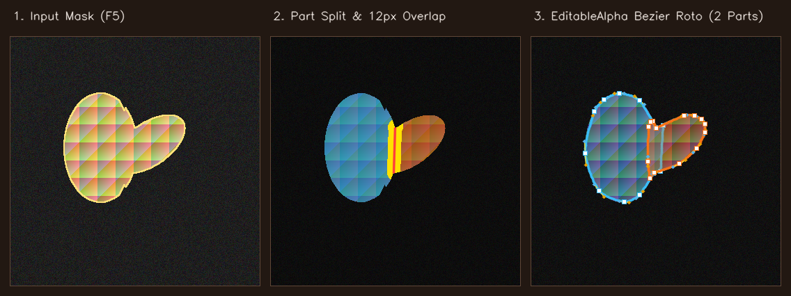
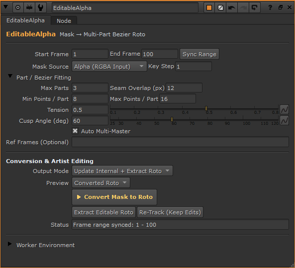
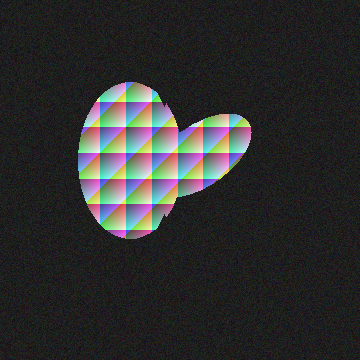
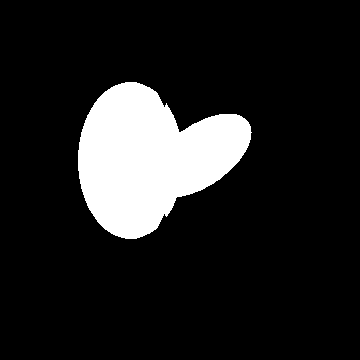

<a id="top"></a>

# EditableAlpha — Foundry Nuke Mask-to-Roto Gizmo

<div align="center">

**🌐 Language / 언어 선택:** &nbsp;
[**🇰🇷 한국어**](#korean) &nbsp;&nbsp;|&nbsp;&nbsp; [**🇺🇸 English**](#english)

</div>

---

<a id="korean"></a>

# 🇰🇷 한국어 (Korean)

<p align="right">
  <a href="#english"><b>🌐 Switch to English (영문 버전 보기)</b></a>
</p>

**EditableAlpha**는 생성된 래스터 알파 마스크(매트/RGBA 시퀀스)를 입력으로 연결하면 **다중 파트 3차 베지에(Cubic Bézier) Roto 셰이프**로 자동 변환해 주는 **Foundry Nuke 17.1+ 전용 Gizmo 툴**입니다.

Nuke 내장 Python(NumPy/OpenCV 미설치 환경)과의 충돌을 피하기 위해, Nuke 내부에서는 순수 표준 라이브러리 브리지([editablealpha_bridge.py](editablealpha_bridge.py))만 동작하고 무거운 기하·추적 연산은 외부 Python 워커([editablealpha_worker.py](editablealpha_worker.py)) 서브프로세스로 분리 실행합니다.




---

## 1. Nuke 설치 방법 (1줄 등록)

`~/.nuke/init.py` (Windows 예: `C:\Users\<사용자명>\.nuke\init.py`)에 아래 2줄을 추가하면 Nuke 실행 시 `EditableAlpha.gizmo`와 메뉴/단축키가 자동 등록됩니다.

```python
import nuke
nuke.pluginAddPath(r"C:\Users\<사용자명>\.nuke\AlphaToRoto")
```

*(또는 `~/.nuke` 내부에 위치한 경우 `nuke.pluginAddPath('AlphaToRoto')`)*

- **툴바 메뉴**: `Nodes > EditableAlpha > EditableAlpha (Mask to Roto)`
- **단축키**: `Ctrl+Alt+E`
- **상단 메뉴**: `EditableAlpha > Check Worker Python Environment` (외부 Python `cv2`/`numpy` 연결 상태 확인)

---

## 2. 사용 방법 (Mask Input ➔ Editable Roto)



1. Nuke 그래프에서 알파 마스크 노드(예: `Read`, `Keylight`, `SAM2`/`AlphaGen` 출력 등)를 선택하고 **`Ctrl+Alt+E`** (또는 `Tab` → `EditableAlpha`)로 노드를 생성해 입력(`mask`)에 연결합니다.
2. **`Sync Range`** 버튼을 눌러 입력 시퀀스 프레임 범위(`Start Frame` / `End Frame`)를 맞춥니다.
3. 필요 시 파라미터를 조정합니다:
   - **Mask Source**: `Alpha (RGBA Input)` 또는 `Luminance (RGB/BW)`
   - **Max Parts / Seam Overlap (px)**: 관절 단위 파트 분할 개수 및 이음새 겹침 마진(기본 `12 px`)
   - **Min / Max Points / Part**: 파트당 제어점 개수
   - **Auto Multi-Master**: 움직임이 큰 시퀀스에서 대표 기준 프레임을 자동 다중 선출
   - **Output Mode**:
     - `Update Internal + Extract Roto` *(기본)*: Gizmo 내부 Roto 업데이트 + 그래프에 독립 `Roto` 노드 자동 추출
     - `Update Internal Gizmo Only`: Gizmo 내부 Roto만 갱신
     - `Extract Standalone Roto Only`: 독립 `Roto` 노드만 생성/갱신
   - **Preview**: `Converted Roto` / `Input Mask` A/B 전환
4. **`▶ Convert Mask to Roto`** 클릭 → 입력 마스크가 편집 가능한 다중 파트 베지에 `Roto` 노드로 변환됩니다.
5. **수동 수정 후 재추적**: 추출된 `Roto` 노드에서 현재 프레임의 제어점/핸들을 직접 수정한 뒤, Gizmo의 **`Re-Track (Keep Edits)`** 를 누르면 수정한 제어점이 100% 보존된 상태로 인접 프레임이 부드럽게 재추적됩니다.

---

## 3. 테스트 샘플 이미지 (Sample Test Sequences)

저장소에 포함된 15프레임 테스트 시퀀스를 Nuke `Read` 노드로 불러와 `EditableAlpha` 입력(`mask`)에 바로 연결해 테스트할 수 있습니다.

| 구분 | 경로 | 설명 | 미리보기 (F5) |
| :--- | :--- | :--- | :---: |
| **Nuke RGBA 테스트** | `sample_sequences/rgba_nuke/rgba_####.png` | `Read` 노드에 연결 즉시 Alpha 채널이 포함된 테스트 시퀀스 (`1–15f`) |  |
| **바이너리 마스크** | `sample_sequences/masks/mask_####.png` | 흑백 알파 마스크 시퀀스 (`1–15f`, `Mask Source: Luminance` 또는 `Alpha`) |  |
| **원본 RGB 플레이트** | `sample_sequences/rgb/frame_####.png` | 배경이 포함된 원본 RGB 이미지 시퀀스 (`1–15f`) | — |

---

## 4. 헤드리스 테스트 실행

Nuke GUI를 켜지 않고도 워커 서브프로세스, Gizmo 구조, 수동 수정 보존, Roto 좌표 변환을 검증할 수 있습니다.

```bash
python -m unittest discover -s tests -v
```

<br>
<p align="center">
  <a href="#top"><b>⬆️ 맨 위로 이동 (Back to Top)</b></a> &nbsp;|&nbsp; <a href="#english"><b>🌐 Switch to English</b></a>
</p>

---
---

<a id="english"></a>

# 🇺🇸 English

<p align="right">
  <a href="#korean"><b>🌐 한국어로 전환 (Switch to Korean)</b></a>
</p>

**EditableAlpha** is a **Foundry Nuke 17.1+ Gizmo tool** that takes a raster alpha mask (matte or RGBA sequence) as input and automatically converts it into **multi-part Cubic Bézier Roto shapes**.

To avoid dependency conflicts with Nuke's bundled Python (which lacks NumPy/OpenCV), Nuke runs only a pure standard-library bridge ([editablealpha_bridge.py](editablealpha_bridge.py)) internally, while offloading heavy geometry and tracking computation to an external Python worker subprocess ([editablealpha_worker.py](editablealpha_worker.py)).


---

## 1. Nuke Installation (1-Line Setup)

Add the following two lines to `~/.nuke/init.py` (e.g. `C:\Users\<Username>\.nuke\init.py` on Windows) so `EditableAlpha.gizmo`, menus, and shortcuts are registered automatically on Nuke startup:

```python
import nuke
nuke.pluginAddPath(r"C:\Users\<Username>\.nuke\AlphaToRoto")
```

*(Or `nuke.pluginAddPath('AlphaToRoto')` if placed directly inside `~/.nuke`)*

- **Toolbar Menu**: `Nodes > EditableAlpha > EditableAlpha (Mask to Roto)`
- **Shortcut**: `Ctrl+Alt+E`
- **Top Menu**: `EditableAlpha > Check Worker Python Environment` (verifies external Python `cv2`/`numpy` availability)

---

## 2. Usage (Mask Input ➔ Editable Roto)


1. Select an alpha mask node in the Nuke Node Graph (e.g., `Read`, `Keylight`, `SAM2`/`AlphaGen` output), press **`Ctrl+Alt+E`** (or `Tab` → `EditableAlpha`), and connect it to the `mask` input.
2. Click **`Sync Range`** to match `Start Frame` / `End Frame` to the connected input sequence.
3. Adjust parameters as needed:
   - **Mask Source**: `Alpha (RGBA Input)` or `Luminance (RGB/BW)`
   - **Max Parts / Seam Overlap (px)**: Maximum articulated part count and overlap margin between adjacent parts (default: `12 px`)
   - **Min / Max Points / Part**: Control point budget per part
   - **Auto Multi-Master**: Automatically selects multiple master keyframes across sequences with large motion
   - **Output Mode**:
     - `Update Internal + Extract Roto` *(Default)*: Updates the internal Roto node and extracts a standalone `Roto` node into the graph
     - `Update Internal Gizmo Only`: Updates only the internal Gizmo Roto
     - `Extract Standalone Roto Only`: Creates/updates only the standalone `Roto` node
   - **Preview**: Toggle between `Converted Roto` and `Input Mask`
4. Click **`▶ Convert Mask to Roto`** to convert the input mask into editable multi-part Bézier `Roto` curves.
5. **Re-Tracking After Manual Edits**: Adjust control points or tangent handles directly on the extracted `Roto` node at the current frame, then click **`Re-Track (Keep Edits)`** on the Gizmo to smoothly re-track adjacent frames while preserving your manual edits 100%.

---

## 3. Sample Test Sequences

A 15-frame test sequence is included in the repository so you can load it via a Nuke `Read` node and connect it directly to `EditableAlpha`'s `mask` input:

| Category | Path | Description | Preview (F5) |
| :--- | :--- | :--- | :---: |
| **Nuke RGBA Test** | `sample_sequences/rgba_nuke/rgba_####.png` | Ready-to-use RGBA sequence with embedded Alpha (`1–15f`) |  |
| **Binary Mask** | `sample_sequences/masks/mask_####.png` | Grayscale binary mask sequence (`1–15f`, `Mask Source: Luminance` or `Alpha`) |  |
| **Source RGB Plate** | `sample_sequences/rgb/frame_####.png` | Original RGB plate sequence with background (`1–15f`) | — |

---

## 4. Headless Testing

You can verify the worker subprocess, Gizmo syntax/knobs, manual edit preservation, and Roto coordinate round-trips without launching the Nuke GUI:

```bash
python -m unittest discover -s tests -v
```

<br>
<p align="center">
  <a href="#top"><b>⬆️ Back to Top (맨 위로 이동)</b></a> &nbsp;|&nbsp; <a href="#korean"><b>🌐 한국어로 전환</b></a>
</p>
