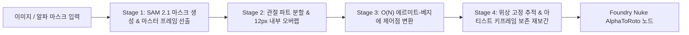

# AlphaToRoto

추적 생성된 픽셀 단위의 래스터 알파 마스크 시퀀스를 작업자(아티스트)가 직관적으로 수정할 수 있는 **시공간 위상 일관형 다중 파트 3차 베지에(Cubic Bézier) 로토스코핑 셰이프**로 변환하고, **Python 기반 Foundry Nuke 테스트 환경** 및 **대화형 웹/CLI 실험 환경**과 연동하는 전체 프로젝트 시스템(`AlphaToRoto`) 구현체입니다.

---

## 1. 프로젝트 원리 쉽게 이해하기 (How It Works)

### 💡 왜 AlphaToRoto가 필요한가요?

* **기존 AI 마스크(SAM 2 등)의 한계**: AI가 뽑아주는 마스크는 픽셀 격자(래스터 이미지) 형태입니다. 픽셀 덩어리에는 **제어점(Anchor)과 곡선 핸들(Tangent Handle)이 없기 때문에**, VFX 아티스트가 Nuke에서 경계를 살짝 고치거나 타임라인 커브를 보정하려면 처음부터 로토 셰이프를 다시 그려야 합니다.
* **단순 프레임별 벡터화의 한계**: 매 프레임 외곽선을 따로 베지에 곡선으로 변환하면 프레임마다 제어점 개수($N$)와 번호가 달라져 **점이 경계를 따라 미끄러지거나(Vertex Swimming) 곡선이 뒤틀리는 현상**이 생깁니다.
* **AlphaToRoto의 해결책**: 가장 선명하고 관절이 잘 드러난 **단 하나의 기준 프레임($F_{\text{master}}$)**에서 마스크를 **관절 단위로 분할**하고 **적은 개수의 3차 베지에 제어점**으로 바꾼 뒤, 그 위상(점 개수·순서)을 고정한 채 전체 프레임으로 전파합니다. 덕분에 아티스트가 어느 프레임을 수정하든 해당 수정이 **100% 보존되면서 주변 프레임만 매끄럽게 재추적**됩니다.

### 🔄 전체 파이프라인 흐름



### ⚙️ 4단계 핵심 원리

1. **Stage 1 — 대표 기준 프레임($F_{\text{master}}$) 자동 선출 (식 1)**
   * RGB 이미지가 들어오면 **SAM 2.1**이 클릭/박스 프롬프트를 받아 전 프레임의 마스크를 생성하고, 이미 알파 마스크 시퀀스가 있다면 그대로 불러옵니다(불투명 RGBA PNG는 RGB 휘도로 자동 폴백).
   * 이후 전체 프레임 중 **① 마스크 면적이 크고(`Area`)**, **② 목·팔·다리 등 관절의 오목한 꺾임이 뚜렷하며(`N_defects`)**, **③ 모션 블러가 가장 적은(`BlurPenalty`)** 프레임 한 장을 자동 선출합니다. 이 프레임이 전체 시퀀스의 셰이프 설계도($F_{\text{master}}$)가 됩니다.

2. **Stage 2 — 관절 기반 파트 분할 & `10~15 px` 내부 오버랩 마진 (식 2)**
   * 사람이나 동물을 하나의 둥근 폐곡선으로만 감싸면 팔·머리가 움직일 때 베지에 곡선이 꼬이기 쉽습니다.
   * AlphaToRoto는 마주 보는 오목한 관절 핀치(예: 목 양쪽 경계)와 광학 흐름(Optical Flow) 움직임 차이를 기준으로 **머리·몸통 등 준강체 파트로 깔끔하게 분리**합니다.
   * 이때 절단선 안쪽으로 기본 **`12 px`(`10~15 px`) 내부 오버랩 마진**을 겹쳐 생성합니다. 칼로 자른 듯 딱 맞게 자르면 아티스트가 한 파트를 움직였을 때 이음새가 쩍 갈라지지만(Seam Gap), **안쪽을 겹쳐 두면 개별 파트를 수정·회전해도 내부 빈틈이 `0%`로 유지**됩니다.

3. **Stage 3 — $O(N)$ 닫힌 형태 에르미트-베지에 변환 (식 3~5)**
   * 픽셀 외곽선의 자글자글한 계단 노이즈를 다듬고(이미지 테두리에 닿은 경계는 직각 위치 유지), 곡률 변화가 큰 지점 위주로 **희소한 제어점 $\{P_0, \dots, P_{N-1}\}$**을 뽑습니다.
   * 반복적인 수치 최적화 대신, 에르미트 접선 벡터 $V_i = \tau_i(P_{i+1} - P_{i-1})$로부터 3차 베지에의 좌우 핸들($\Delta h_i^{\text{out}} = +\frac{1}{3}V_i$, $\Delta h_i^{\text{in}} = -\frac{1}{3}V_i$)을 **$O(N)$ 한 번의 계산으로 즉시 합성**합니다.
   * $60^\circ$ 이상 날카롭게 꺾이는 모서리(첨점)에서는 핸들 길이($\tau_i \to 0$)를 자동으로 접어 베지에 곡선이 동그랗게 부풀거나 꼬이는 루프 현상을 막습니다.

4. **Stage 4 — 위상 고정 전파 & 아티스트 키프레임 100% 보존 재추적 (식 6~8)**
   * 기준 프레임에서 정해진 제어점 개수($N$)와 번호를 전 프레임에 고정한 채 순·역방향 추적 및 윤곽선 스냅핑을 수행합니다.
   * 작업자가 중간 프레임을 직접 수정하면 해당 프레임은 **보호 키프레임($k_m \in K$)으로 100% 비파괴 보존**되며, 양옆 키프레임 사이 구간만 **$C^1$ Smoothstep($s(t) = 3t^2 - 2t^3$) 가시성 가중 블렌딩(식 6~7)**과 **할선 회전 탄젠트 보정(식 8)**으로 자연스럽게 재계산되어 Foundry Nuke `AlphaToRoto` 노드로 출력됩니다.

---

## 2. 파일 구성 (Module Architecture)

Web UI 중심 워크플로를 기준으로 중복 코드를 제거하고 핵심 3개 파이프라인 모듈 + 경량 웹/Nuke 어댑터로 정리되어 있습니다.

1. **`mask_generator.py` — Stage 1: SAM 2.1 분할, Vector Flow 분석 및 다중 대표 프레임 선출 (식 1)**
   * 알파 마스크/RGBA 이미지 디코딩(`decode_binary_mask_array`), 마스크 프리뷰 캔버스(`make_mask_preview_plate`), SAM 2.1 GPU 및 GrabCut + Optical Flow 폴백(`segment_and_track`).
   * 전경 면적(`Area`), 오목 결함 개수(`N_defects`), 모션 블러 페널티(`BlurPenalty`)와 오브젝트 Vector Flow(`compute_object_vector_flow_profile`)를 결합해 정적 구간에서는 1개, 큰 움직임 구간에서는 2개 이상의 대표 프레임을 자동 선출(`select_master_frame`, `select_representative_master_frames`).
2. **`roto_geometry.py` — Stage 2 & 3 통합 기하 모듈: 관절 파트 분할 & O(N) 에르미트-베지에 피팅 (식 2~5)**
   * **Stage 2**: 마주 보는 오목 핀치와 광학 흐름 아핀 잔차로 준강체 파트 분리 및 `10~15 px` 내부 오버랩 마진 부여(`find_optimal_cut_lines`, `decompose_mask_into_parts`), 파트별 개별 오버랩/경계 오프셋 재계산(`rebuild_part_overlap_mask`, `compute_parts_overlap_stats`).
   * **Stage 3**: 외곽선 스무딩(`extract_ordered_contour`), 곡률 적응형 제어점 추출(`select_curvature_adaptive_anchors`), 첨점 대응 텐션 계산(`compute_adaptive_tensions`), 닫힌 형태 에르미트-베지에 핸들 합성(`contour_to_hermite_bezier`), $\mathcal{J}$/$\mathcal{F}$/RMSE 평가 및 표 1 비교 베이스라인(`rdp_polygon_vectorize`, `sam2_autotrace_vectorize`, `least_squares_bspline_fit`) 포함.
3. **`autoroto_pipeline.py` — Stage 4: 통합 파이프라인 엔진 & 위상 고정 전파·내보내기 (식 6~8)**
   * Stage 1~4 단계별 단일 실행 API(`select_stage1_masters`, `run_stage2_decompose`, `run_stage3_fit_parts`, `run_stage4_propagate`)와 전체 실행(`build_editable_roto_from_masks`).
   * 동적 파트 마스크 추적(`build_dynamic_part_masks_sequence`), 보조 대표 프레임 단조 호장 피팅(`synthesize_linked_master_keyframe_cps`), $C^1$ Smoothstep 가시성 가중 블렌딩(`blend_bidirectional_trajectories`), 할선 회전 탄젠트 보정(`compute_rotated_tangents`), 비파괴 키프레임 수정(`apply_artist_keyframe_edit`), Nuke/SVG/JSON 내보내기 제공.
4. **`alphatoroto_web_studio.py` & `web_ui/index.html` — 대화형 Web Studio**
   * `autoroto_pipeline.py`와 `mask_generator.py`를 직접 호출하는 경량 FastAPI 서버 및 브라우저 UI.
   * 이미지/마스크 업로드 → Stage 1(SAM 2.1 + Vector Flow 다중 마스터) → Stage 2(파트별 개별 View/Solo/Active 토글 & Overlap/Edge Offset 실시간 조정) → Stage 3(베지에 생성) → Stage 4(다중 마스터 연동 추적 & 캔버스 키프레임 드래그 편집) → Nuke `AlphaToRoto` 노드 생성까지 한 화면에서 수행합니다.
5. **`nuke_bridge.py` — 경량 Foundry Nuke 연동 브리지**
   * Web Studio에서 내보낸 프로젝트 JSON 또는 Python 스크립트를 Nuke Roto 노드의 `AlphaToRoto` Tab 1으로 불러오거나(`load_alphatoroto_json_as_node`, `create_autoroto_node`), Nuke 내 입력 알파를 즉시 Stage 1~4 다중 파트 베지에 로토로 변환합니다(`on_node_convert_alpha_to_roto`).
6. **`run_paper_experiments.py` & `test_human_in_the_loop_mask.py` — 논문 표 1~3 벤치마크 및 전체 통합 테스트**
   * 표 1~3 정량 실험 결과 생성(`experiment_results/`) 및 Stage 1~4 + Web Studio API 8종 통합 검증을 담당합니다.

---

## 3. 직접 테스트 실행 가이드 (Quick Start)

### ① 전체 파이프라인 웹 UI (SAM 2.1 + 파트별 조정 + Vector Flow 다중 마스터 + Nuke 연동) 실행

```bash
python alphatoroto_web_studio.py --host 127.0.0.1 --port 8765
```

- 실행 후 브라우저에서 **`http://127.0.0.1:8765`** 로 접속하면 이미지 입력 → Stage 1(SAM 2.1 & Vector Flow) → Stage 2(파트별 토글/오버랩 조정) → Stage 3 → Stage 4 → Nuke `AlphaToRoto` 노드 생성까지 순서대로 즉시 테스트할 수 있습니다.

### ② 단위·통합 테스트 실행 (Stage 1~4 수식, Nuke 브리지 & Web Studio API 검증)

```bash
python test_human_in_the_loop_mask.py
```

### ③ 논문 실험 1~3 (표 1, 표 2, 표 3) 정량 벤치마크 실행

```bash
python run_paper_experiments.py
```

- 실행 완료 시 `experiment_results/PAPER_TABLES_1_2_3.md` 및 `experiment_results/experiment_metrics.json`에 표 1~3의 모든 측정 수치가 출력됩니다.
